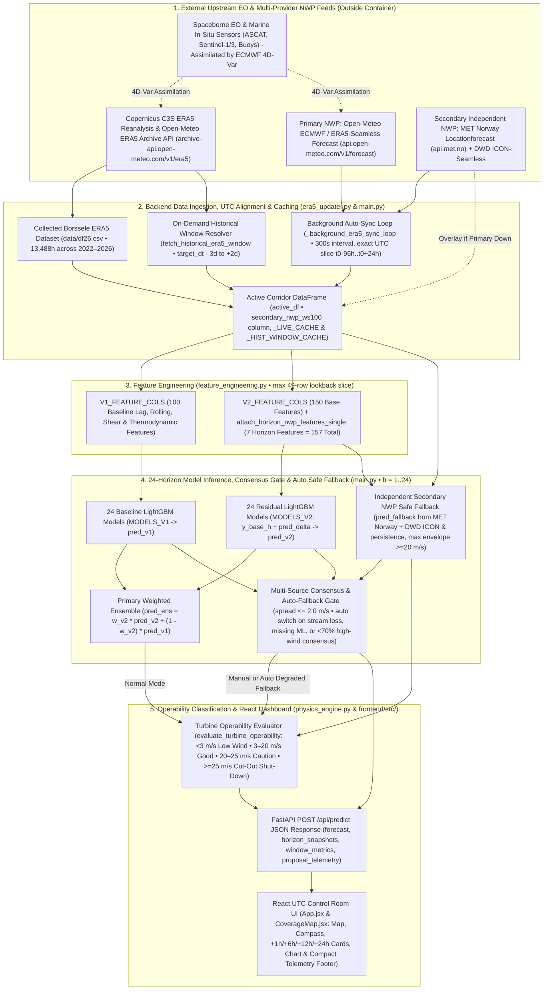

# WindGuard: Operational Earth Observation Service to Predict Offshore Wind Park Shut-Down Events

**Authors:** Raphael Cochez, Pasan Merengnage, Mariia Melnikova  

**Core Research & Operational Question:**  
> *Using collected Copernicus ERA5 satellite reanalysis and NWP data, can we make a sufficiently timely and accurate prediction of offshore wind park shut-down events ($\ge 25.0\text{ m/s}$) for grid-operator decision-makers to make an informed operational decision?*

---

## Abstract

Offshore wind energy corridors in the North Sea and Baltic Sea supply an increasing share of European high-voltage transmission capacity. During severe extratropical cyclones, however, $100\text{ m}$ hub-height wind speeds exceeding the **$25.0\text{ m/s}$ turbine cut-out threshold** trigger automated protective blade feathering and park-wide disconnection. Rapid, unanticipated loss of hundreds of megawatts to gigawatts of offshore generation within a single $0.25^\circ \times 0.25^\circ$ grid cell threatens grid frequency stability and requires transmission system operators (TSOs) to pre-allocate balancing reserves hours in advance.

This research project designs, implements, and evaluates an end-to-end **Operational Earth Observation (EO) and Numerical Weather Prediction (NWP) Service** that combines **Copernicus C3S ERA5 reanalysis** (`reanalysis-era5-single-levels` / archive) with **ECMWF IFS / Open-Meteo ERA5-Seamless primary NWP**, independent **MET Norway (`api.met.no`) and DWD `icon_seamless` secondary NWP feeds**, and a **24-horizon physics-informed residual LightGBM ensemble (`wind_forecast_v2`)**. Strictly excluding turbine power-delivery estimation, the service focuses on $100\text{ m}$ hub-height wind speed forecasting (`+1h` to `+24h` maximum) and four-regime turbine operability classification. Across **$3{,}240\text{ hours}$** of held-out 2026 evaluation data, the physics-informed `v2` ensemble reduces $+24\text{h}$ forecast RMSE from $3.603\text{ m/s}$ (baseline direct GBDT `v1`) to **$1.161\text{ m/s}$** ($67.8\%$ reduction) and cuts high-wind ($>12\text{ m/s}$) under-prediction bias from $-4.223\text{ m/s}$ to **$-0.439\text{ m/s}$**. Across three historical North Sea storm case studies at Borssele (**Storm Eunice**, **Storm Ciarán**, and the **2025 New Year Gale**), the system achieves **$92.6\%$–$97.9\%$** continuous wind forecast accuracy over the $+24\text{h}$ window and accurately identifies both protective cut-out shut-downs and near-threshold high-wind caution regimes.

---

## Table of Contents

1. [System Scope & Wind Operability Regimes](#1-system-scope--wind-operability-regimes)
2. [Space-to-Grid Dependency & Data Flow Architecture](#2-space-to-grid-dependency--data-flow-architecture)
3. [System-of-Systems (SoS) Architecture](#3-system-of-systems-sos-architecture)
4. [Physical & Machine Learning Methodology](#4-physical--machine-learning-methodology)
5. [Quantitative Model Evaluation (`+1h` to `+24h`)](#5-quantitative-model-evaluation-1h-to-24h)
6. [Historical Event Timeline Analysis & Live Cross-Validation](#6-historical-event-timeline-analysis--live-cross-validation)
7. [Critical-Failure & Resilience Analysis](#7-critical-failure--resilience-analysis)
8. [Automatic Safe Fallback Protocol & Multi-Source Consensus](#8-automatic-safe-fallback-protocol--multi-source-consensus)
9. [Repository Structure, API, Tests & Quick Start](#9-repository-structure-api-tests--quick-start)

---

## 1. System Scope & Wind Operability Regimes

### 1.1 Physical Wind Regime Classification

Strictly avoiding turbine power-delivery curve estimation, the physics engine ([`borssele-digital-twin/backend/app/physics_engine.py`](borssele-digital-twin/backend/app/physics_engine.py)) evaluates whether an offshore wind park **can operate safely** at a given $100\text{ m}$ hub-height wind speed $W_{100}$ across four thresholds centralized in [`config.py`](borssele-digital-twin/backend/app/config.py):

| Wind Speed Range ($W_{100}$) | Operational State Code | `can_operate` | Dashboard Label | Aerodynamic & Grid Operator Meaning |
| :--- | :--- | :---: | :--- | :--- |
| **$W_{100} < 3.0\text{ m/s}$** | `LOW_WIND_STANDBY` | `True` | `Low Wind (<3 m/s • Can Operate)` | Safe mechanical envelope (no storm shut-down risk); wind speed is below the $3.0\text{ m/s}$ cut-in threshold. |
| **$3.0 \le W_{100} < 20.0\text{ m/s}$** | `GOOD_CONDITIONS` | `True` | `Good Conditions (3–20 m/s)` | Nominal turbine operating envelope; maintain standard grid dispatch and routine $1\text{h}$ verification cycle. |
| **$20.0 \le W_{100} < 25.0\text{ m/s}$** | `HIGH_WIND_CAUTION` | `True` | `High Wind Caution (20–25 m/s)` | Approaching cut-out ($< 5.0\text{ m/s}$ safety margin); place secondary NWP consensus watch on standby and pre-allocate spinning reserves. |
| **$W_{100} \ge 25.0\text{ m/s}$** | `CUT_OUT_SHUTDOWN` | `False` | `Cut-Out Shut-Down (≥25 m/s)` | **Protective Storm Shut-Down:** Wind speed meets/exceeds $25.0\text{ m/s}$, triggering automated $90^\circ$ blade pitch feathering and park disconnection. |

### 1.2 Monitored Offshore Wind Corridors (`0.25° × 0.25°` ERA5 Grid Cells)

Defined in [`borssele-digital-twin/backend/app/era5_updater.py`](borssele-digital-twin/backend/app/era5_updater.py), the service covers five European offshore wind corridors mapped to their enclosing ERA5 $0.25^\circ \times 0.25^\circ$ grid cell:

| Corridor ID | Offshore Wind Zone | Query Coordinates | ERA5 Grid Center | ERA5 $0.25^\circ \times 0.25^\circ$ Bounding Box | Sea Basin |
| :--- | :--- | :---: | :---: | :--- | :--- |
| `borssele` | **Borssele Offshore Wind Zone (NL)** | `51.7167° N, 3.0000° E` | `51.750° N, 3.000° E` | `51.625°N – 51.875°N`, `2.875°E – 3.125°E` (`478 km²`) | Southern North Sea |
| `hollandse_kust` | **Hollandse Kust Zuid & Noord (NL)** | `52.3000° N, 4.1000° E` | `52.250° N, 4.000° E` | `52.125°N – 52.375°N`, `3.875°E – 4.125°E` (`472 km²`) | Central Dutch Coast |
| `dogger_bank` | **Dogger Bank Offshore Wind Zone (UK)** | `54.7500° N, 2.2500° E` | `54.750° N, 2.250° E` | `54.625°N – 54.875°N`, `2.125°E – 2.375°E` (`446 km²`) | Central North Sea |
| `hornsea` | **Hornsea Offshore Wind Zone (UK)** | `53.8800° N, 1.8000° E` | `53.875° N, 1.750° E` | `53.750°N – 54.000°N`, `1.625°E – 1.875°E` (`455 km²`) | Western North Sea |
| `tahkoluoto` | **Tahkoluoto Offshore Wind Farm (FI)** | `61.6261° N, 21.3581° E` | `61.625° N, 21.375° E` | `61.500°N – 61.750°N`, `21.250°E – 21.500°E` (`368 km²`) | Bothnian Sea, Baltic |

---

## 2. Space-to-Grid Dependency & Data Flow Architecture

The diagram below documents the end-to-end data flow implemented in the service—explicitly distinguishing **upstream space/assimilation providers** (outside the container) from the **ingestion, feature engineering, LightGBM inference, fallback, and physics classification pipelines** running inside the FastAPI + React container:



### Subsystem Dependency Matrix

| Dependency Link | Upstream Provider / Script | Downstream Module | Exchanged State Vector / Artifact | Criticality |
| :--- | :--- | :--- | :--- | :--- |
| **D1: Spaceborne Wind & Pressure** | EUMETSAT / ESA (`MetOp`, `Sentinel-1/3`) | ECMWF 4D-Var Assimilation | Ocean surface scatterometry & altimetry assimilated externally into ERA5 / IFS | **High** (Upstream physical foundation) |
| **D2: Primary Reanalysis & Multi-Provider NWP** | Copernicus C3S (`ecmwf-datastores-client` optional), Open-Meteo ERA5/Forecast, **MET Norway (`api.met.no`)**, & **DWD `icon_seamless`** | [`era5_updater.py`](borssele-digital-twin/backend/app/era5_updater.py) | 10 core hourly variables ($u_{100}, v_{100}, u_{10}, v_{10}, d_{2\text{m}}, t_{2\text{m}}, \text{msl}, \text{sp}, \text{tcc}, \text{tp}$), gusts (`i10fg`), plus independent `secondary_nwp_ws100` | **Critical** (Supplies UTC context window, $+24\text{h}$ primary guidance, and independent NWP redundancy) |
| **D3: Feature Tensor Construction** | [`feature_engineering.py`](borssele-digital-twin/backend/app/feature_engineering.py) | [`main.py`](borssele-digital-twin/backend/main.py) & [`train_models.py`](borssele-digital-twin/backend/train_models.py) | `100` features (`V1_FEATURE_COLS`) + `157` horizon features (`V2_FEATURE_COLS` + `7` NWP/target features) | **Critical** (Vectorized tabular input for LightGBM) |
| **D4: Multi-Horizon Inference & Auto-Fallback** | `wind_forecast_v1` & `wind_forecast_v2` + Independent `nwp_secondary` | [`physics_engine.py`](borssele-digital-twin/backend/app/physics_engine.py) | Predicted $100\text{ m}$ wind speed $\widehat{W}_{100}(t+h)$ for $h \in \{1,\dots,24\}$ with automatic switchover (`AUTO_FALLBACK_*`) | **High** (Backed by independent Secondary NWP Safe Fallback) |
| **D5: Decision & Telemetry UI** | FastAPI `POST /api/predict` | [`App.jsx`](borssele-digital-twin/frontend/src/App.jsx) & [`CoverageMap.jsx`](borssele-digital-twin/frontend/src/components/CoverageMap.jsx) | Operable hours ($X/H\text{h}$), cut-out margin, consensus score, latency/freshness telemetry, and TSO dispatch guidance | **Critical** (Control room decision interface) |

---

## 3. System-of-Systems (SoS) Architecture

The service integrates four constituent components operating across external meteorological services and the local containerized application:

1. **Constituent System 1 — Copernicus C3S ERA5 Reanalysis Archive:**
   Provides homogeneous hourly atmospheric state vectors over a $0.25^\circ \times 0.25^\circ$ latitude-longitude grid ($\approx 478\text{ km}^2$ at Borssele). Local Borssele reanalysis is stored in [`borssele-digital-twin/backend/data/df26.csv`](borssele-digital-twin/backend/data/df26.csv), while historical dates or other corridors are fetched on demand via the Open-Meteo ERA5 Archive API (`archive-api.open-meteo.com/v1/era5`) or optionally via Copernicus CDS (`ecmwf-datastores-client` when `CDS_API_KEY` or `~/.ecmwfdatastoresrc` is configured).
2. **Constituent System 2 — Dual-Stream Operational NWP Feeds (Open-Meteo Primary + MET Norway / DWD ICON Secondary):**
   The primary stream queries Open-Meteo ECMWF/ERA5-Seamless (`api.open-meteo.com/v1/forecast`) for hourly `wind_speed_100m`, `wind_direction_100m`, `wind_speed_10m`, `wind_direction_10m`, `wind_gusts_10m`, `temperature_2m`, `dew_point_2m`, `pressure_msl`, `surface_pressure`, `cloud_cover`, and `precipitation` (`past_days=4`, `forecast_days=2`), sliced strictly on UTC hour boundaries to `[utc_now_hour - 96h, utc_now_hour + 24h]` and converted into $(u, v)$ vectors and SI units (`K`, `Pa`, `0..1`, `m`). In parallel, `_fetch_secondary_nwp_streams` polls **MET Norway Locationforecast (`api.met.no`)** (extrapolating $10\text{ m}$ wind to $100\text{ m}$ hub height via the offshore neutral power law $\alpha = 0.11$) and **DWD ICON-Seamless (`icon_seamless`)** to populate an independent `secondary_nwp_ws100` reference series that persists even if the primary feed drops out.
3. **Constituent System 3 — Backend Forecasting, Auto-Fallback & Operability Engine ([`borssele-digital-twin/backend/`](borssele-digital-twin/backend)):**
   Runs a FastAPI server whose `_background_era5_sync_loop` refreshes all 5 corridors every $300\text{ s}$, extracts up to `49` hourly context rows (`current_idx - 48` through `current_idx`), evaluates all 24 `v1` and `v2` LightGBM boosters, checks multi-source spread against independent `nwp_secondary`, automatically triggers `degraded_fallback` on primary outage, missing `v2` models, or high-wind divergence (`< 70%` consensus at $\ge 20.0\text{ m/s}$), and classifies every future hour through [`physics_engine.py`](borssele-digital-twin/backend/app/physics_engine.py).
4. **Constituent System 4 — Grid Operator Web Dashboard ([`borssele-digital-twin/frontend/`](borssele-digital-twin/frontend)):**
   A React + Vite + Tailwind + Recharts interface providing corridor selection, horizon switching (`+1h`, `+6h`, `+12h`, `+24h` max), operational mode selection (`Live Now`, `Live Safe Fallback`, the 3 historical North Sea events, or custom UTC `Year / Month / Day / Hour` capped strictly at current `UTC` time), an interactive slippy tile coverage map (OSM / Dark Marine + OpenSeaMap seamarks, `z6`–`z11`) with a pinned 8-point compass rose and `16`-sector bearing badge, a unified forecast & threshold trajectory chart, and a compact Grid Operator Decision & telemetry footer (`Mode`, `Freshness`, `Latency`, `Fallback`).

---

## 4. Physical & Machine Learning Methodology

### 4.1 Exploratory 10-Year Climatological Baseline (`2016–2025`)

Prior to building the operational forecasting pipeline, a 10-year Copernicus ERA5 reanalysis study (`2016–2025`) was conducted for the Borssele Offshore Wind Farm (`51.716667°N, 3.000000°E`) in [`10_years_Analysis_Borssele_offshore_wind_farm.ipynb`](10_years_Analysis_Borssele_offshore_wind_farm.ipynb). Key empirical findings directly motivating the model architecture include:
- **Heavy-Tail Storm Sparsity:** Across the full 10-year ERA5 sample, 100m wind speed quantiles are `10.08 m/s` (50%), `13.73 m/s` (75%), `17.17 m/s` (90%), `19.64 m/s` (95%), and `23.60 m/s` (99%). Days with daily peak $W_{100} > 25.0\text{ m/s}$ occurred only **20 days across 2016–2025** (`2016: 3`, `2017: 2`, `2018: 1`, `2019: 0`, `2020: 5`, `2021: 3`, `2022: 2`, `2023: 1`, `2024: 3`, `2025: 0`).
- **Seasonal Regime Clustering & Lag Autocorrelation:** Extreme winds cluster heavily in late autumn, winter, and early spring (Nov–Apr), and exhibit strong short-term autocorrelation (`1h–24h` lags) that decays at multi-day lead times—confirming why standard uniform MSE tree regression regresses storm peaks toward the seasonal mean.

### 4.2 Atmospheric Physics & Feature Engineering (`157` Features per Horizon in `v2`)

Implemented in [`borssele-digital-twin/backend/app/feature_engineering.py`](borssele-digital-twin/backend/app/feature_engineering.py), `build_era5_features` and `attach_horizon_nwp_features_*` construct `100` baseline features (`V1_FEATURE_COLS`) and `150` base features (`V2_FEATURE_COLS`: 98 from `v1` excluding `latitude`/`longitude` + 52 `V2_EXTRA_COLS`), plus `7` horizon-specific covariates for each lead time $h \in \{1,\dots,24\}$ (**`157` total features** per `v2` model):

1. **Hub-Height & Surface Scalar Wind Speeds:**
   $$W_{100} = \sqrt{u_{100}^2 + v_{100}^2}, \qquad W_{10} = \sqrt{u_{10}^2 + v_{10}^2}$$
2. **Vertical Scalar Shear, Vector Shear & Hellmann Power-Law Exponent ($\alpha$):**
   $$\Delta W_{100-10} = W_{100} - W_{10}, \qquad \Delta\mathbf{V}_{100-10} = \sqrt{(u_{100}-u_{10})^2 + (v_{100}-v_{10})^2}, \qquad \alpha = \frac{\ln(\max(W_{100}, 0.1) / \max(W_{10}, 0.1))}{\ln(100 / 10)}$$
3. **Ekman Spiral Directional Veering / Backing:**
   Encodes wind direction ($\theta_{100} = \text{atan2}(u_{100}, v_{100})$, $\theta_{10} = \text{atan2}(u_{10}, v_{10})$) and vertical directional shear via `wind_dir_100m_sin/cos`, `veering_sin` $=\sin(\theta_{100} - \theta_{10})$, and `veering_cos` $=\cos(\theta_{100} - \theta_{10})$.
4. **Thermodynamic Air Density & Moisture Proxies:**
   Dry-air equation-of-state density at surface pressure (`sp`) and $2\text{ m}$ temperature (`t2m`) using $R_d = 287.058\text{ J/(kg}\cdot\text{K)}$, plus dew-point depression:
   $$\rho = \frac{\text{sp}}{R_d\,t_{2\text{m}}}, \qquad \Delta T_d = t_{2\text{m}} - d_{2\text{m}}$$
5. **Barometric Pressure Tendencies, Z-Score & Baroclinic Storm Index ($I_{\text{baro}}$):**
   First-order pressure differences ($\Delta\text{MSL}_{1\text{h}, 3\text{h}, 6\text{h}, 12\text{h}, 24\text{h}}$), pressure accelerations ($\text{msl\_accel}_{1\text{h}, 3\text{h}, 6\text{h}}$), 24h rolling pressure Z-score (`msl_zscore_24h` with $+25.0\text{ Pa}$ stabilizer), frontal $t_{2\text{m}}/d_{2\text{m}}$ differences, and the **Baroclinic Storm Index**:
   $$I_{\text{baro}}(t) = -\frac{\Delta\text{MSL}_{6\text{h}}(t)}{100.0} \cdot W_{100}(t)$$
6. **Wind Ramp Rates, Autoregressive Lags, Rolling Windows & EWM Momentum:**
   Wind speed/vector differences and accelerations (`1h–24h`), 48 autoregressive lags at $\{1, 2, 3, 6, 12, 24\}\text{h}$ across 8 variables (`wind_speed_100m`, `shear_100_10`, `msl_diff_3h`, `air_density`, `u100`, `v100`, `tcc`, `tp`), shifted (`v1`) and current-inclusive (`v2`) `6h / 12h / 24h` rolling statistics, and EWM wind momentum (`ewm_ws_3h/6h/12h/24h`, `ws_ewm_macd = ewm_ws_3h - ewm_ws_12h`).
7. **Horizon-Specific Synoptic NWP Guidance Features (`+7` cols $\to$ `157` total):**
   `target_hour_sin`, `target_hour_cos`, `synoptic_nwp_ws_h`, `synoptic_nwp_delta_h`, `synoptic_nwp_u100_h`, `synoptic_nwp_v100_h`, and `synoptic_nwp_msl_delta_h`.
   - *Live operational mode (`is_live_mode=True`):* Computed directly from the incoming Open-Meteo ECMWF/ERA5-Seamless forecast rows around $t + h$ (2-hour causal smoothing, `dispersion = 0.0`).
   - *Offline historical training/backtesting (`is_live_mode=False`):* Synthesized as a 4-hour smoothed synoptic flow at $t + h$ perturbed by a deterministic $\sqrt{h}$-growing phase/amplitude dispersion (`sigma_h = 0.26 * sqrt(h)`) to emulate realistic synoptic NWP spread during training and historical replay.

### 4.3 Physics-Informed Residual LightGBM Formulation (`wind_forecast_v2`)

Direct tree regression (`wind_forecast_v1`) trained solely on state features at $t_0$ suffers from two documented failure modes on extreme storms (`-4.223 m/s` high-wind bias at `+24h`):
1. **Regression-to-the-Mean Leaf Clipping:** Decision trees cannot extrapolate peaks above training leaf means when atmospheric pressure drops are fast-moving over 12h–24h.
2. **Objective / Early-Stopping Mismatch:** Training with an asymmetric objective while evaluating early stopping on symmetric unweighted RMSE stops boosting prematurely.

To resolve both issues in [`borssele-digital-twin/backend/train_models.py`](borssele-digital-twin/backend/train_models.py):
- **Step 1 — Physical Persistence-to-Synoptic Baseline Blend:**
  For each horizon $h \in \{1,\dots,24\}$, a baseline trajectory $y_{\text{base}, h}(t)$ transitions smoothly from initial persistence $W_{100}(t)$ at `+1h` ($\alpha_1 \approx 0.455$) to synoptic NWP guidance $\text{synoptic\_nwp\_ws}_h$ at `+24h` ($\alpha_{24} = 0.920$):
  $$y_{\text{base}, h}(t) = (1 - \alpha_h)\,W_{100}(t) + \alpha_h\,\text{synoptic\_nwp\_ws}_h(t), \qquad \alpha_h = \min\!\left(0.92,\; \frac{h}{h + 1.2}\right)$$
- **Step 2 — Asymmetric Residual Boosting with Aligned Validation Metric:**
  Each LightGBM booster (`num_leaves=31`, `max_depth=6`, `lr=0.03`) predicts the residual $\delta_h(t) = W_{100}(t+h) - y_{\text{base}, h}(t)$ using a custom asymmetric objective paired with a matching validation metric (`asym_wrmse`) in early stopping:
  $$\mathcal{L}_{\text{asym}}(\hat{\delta}_h, \delta_h) = \sum_{i} w_i \left(\hat{\delta}_{h, i} - \delta_{h, i}\right)^2, \qquad w_i = \begin{cases} 1.45 & \text{if } W_{\text{true}, i} > 18.0\text{ m/s and } \widehat{W}_i < W_{\text{true}, i} \\ 1.00 & \text{otherwise} \end{cases}$$
- **Step 3 — Optimal Validation Ensemble Calibration:**
  Validation predictions $\widehat{W}_h^{(v2)} = \max(0, y_{\text{base}, h} + \hat{\delta}_h)$ are blended with $\widehat{W}_h^{(v1)}$ via grid search over $w_{v2, h} \in [0.50, 1.00]$, yielding calibrated weights $w_{v2, h} \in [0.900, 1.000]$ across the 24 horizons.

### 4.4 Continuous Window Evaluation Metrics

To avoid binary boolean accuracy inflation (which reports `100%` whenever both forecast and truth stay below $25\text{ m/s}$), [`borssele-digital-twin/backend/main.py`](borssele-digital-twin/backend/main.py) evaluates each queried horizon window $H \in \{1, 6, 12, 24\}$ using:
- **Continuous Relative Wind Forecast Accuracy ($\text{Acc}_{\text{wind}}$):**
  $$\text{Acc}_{\text{wind}}(H) = \frac{100}{H} \sum_{h=1}^{H} \max\!\left(0,\; 1 - \frac{\left|\widehat{W}_{100}(t+h) - W_{100}(t+h)\right|}{\max\!\left(W_{100}(t+h),\, \widehat{W}_{100}(t+h),\, 4.0\text{ m/s}\right)}\right)$$
- **RMSE, MAE, and Exact 4-Regime Match Rate (`regime_match_pct`).**

---

## 5. Quantitative Model Evaluation (`+1h` to `+24h`)

### Dataset Structure & Chronological Partition (`df26.csv`)

The collected Borssele ERA5 dataset ([`borssele-digital-twin/backend/data/df26.csv`](borssele-digital-twin/backend/data/df26.csv)) contains **`13,488` hourly records** spanning three contiguous segments:
- `2022-02-14 00:00` – `2022-02-21 23:00` (`192` rows, Storm Eunice week, min MSLP `987.0 hPa`)
- `2023-10-29 00:00` – `2023-11-05 23:00` (`192` rows, Storm Ciarán week, min MSLP `961.6 hPa`)
- `2025-01-01 00:00` – `2026-06-30 23:00` (`13,104` rows, 18 continuous months, min MSLP `973.3 hPa`)

To prevent target leakage across segment boundaries, `train_models.py` enforces a strict `contiguous_24h` filter (requiring all 24 future hourly steps to be contiguous), producing **`13,416` valid origin timestamps** split chronologically:
- **Training Split (`< 2026-01-01`):** **`9,096`** contiguous hourly samples
- **Validation Split (`2026-01-01` to `2026-02-14`):** **`1,080`** contiguous hourly samples
- **Held-Out Test Split (`2026-02-15` to `2026-06-30`):** **`3,240`** completely unseen hourly samples

### Benchmark Across Horizons (Held-Out 2026 Test Set, $N = 3{,}240\text{h}$)

All figures below come directly from [`borssele-digital-twin/backend/models/wind_forecast_v2/metrics_summary.json`](borssele-digital-twin/backend/models/wind_forecast_v2/metrics_summary.json):

| Horizon | Persistence RMSE | Direct GBDT (`v1`) RMSE | Physics-Informed (`v2`) Ensemble RMSE | `v2` Ensemble MAE | `v1` High-Wind RMSE (`>12 m/s`) | `v2` High-Wind RMSE (`>12 m/s`) | `v1` High-Wind Bias | `v2` High-Wind Bias |
| :--- | :---: | :---: | :---: | :---: | :---: | :---: | :---: | :---: |
| **`+1h`** | `0.764 m/s` | `0.594 m/s` | **`0.479 m/s`** | `0.345 m/s` | `0.622 m/s` | **`0.470 m/s`** | `+0.092 m/s` | **`-0.032 m/s`** |
| **`+3h`** | `1.792 m/s` | `1.427 m/s` | **`0.734 m/s`** | `0.574 m/s` | `1.332 m/s` | **`0.736 m/s`** | `-0.055 m/s` | **`-0.121 m/s`** |
| **`+6h`** | `2.800 m/s` | `2.302 m/s` | **`0.943 m/s`** | `0.741 m/s` | `2.282 m/s` | **`0.949 m/s`** | `-0.993 m/s` | **`-0.209 m/s`** |
| **`+12h`** | `4.019 m/s` | `3.114 m/s` | **`1.058 m/s`** | `0.823 m/s` | `3.841 m/s` | **`1.057 m/s`** | `-2.678 m/s` | **`-0.292 m/s`** |
| **`+18h`** | `4.535 m/s` | `3.440 m/s` | **`1.206 m/s`** | `0.955 m/s` | `4.630 m/s` | **`1.196 m/s`** | `-3.695 m/s` | **`-0.336 m/s`** |
| **`+24h`** | `4.771 m/s` | `3.603 m/s` | **`1.161 m/s`** | `0.919 m/s` | `5.005 m/s` | **`1.235 m/s`** | `-4.223 m/s` | **`-0.439 m/s`** |

---

## 6. Historical Event Timeline Analysis & Live Cross-Validation

### 6.1 Three Historical North Sea Storm Events at Borssele (`51.72°N, 3.00°E`)

All metrics below are measured directly from `POST /api/predict` (`mode="ensemble"`, `horizon_hours=24`) against Copernicus ERA5 ground truth in `df26.csv`:

| Case Study | Forecast Origin $t_0$ (UTC) | Initial Wind $W_{100}(t_0)$ | Peak ERA5 Truth | Peak `v2` Prediction | ERA5 Shut-Down Duration ($\ge 25\text{ m/s}$) | Predicted Shut-Down Duration ($\ge 25\text{ m/s}$) | `+24h` Wind Accuracy | `+24h` MAE / RMSE | Operational Decision Assessment |
| :--- | :---: | :---: | :---: | :---: | :---: | :---: | :---: | :---: | :--- |
| **Event 1: Storm Eunice** *(KNMI Code Red & TenneT Cut-Out)* | `2022-02-18 06:00` | `16.73 m/s` | **`31.31 m/s`** *(16:00 UTC)* | **`30.22 m/s`** *(16:00 UTC)* | **`10h`** *(12:00–21:00 UTC)* | **`9h`** *(12:00–20:00 UTC)* | **`97.9%`** | `0.52 m/s` / **`0.68 m/s`** | **True Positive Shut-Down:** Forecasts exact `12:00 UTC` cut-out onset ($+6\text{h}$ lead time: `25.32` vs. `25.53 m/s`) and tracks storm peak to within `1.09 m/s`. |
| **Event 2: Storm Ciarán** *(961.6 hPa Bomb Cyclone Cut-Out)* | `2023-11-02 00:00` | `16.99 m/s` | **`32.56 m/s`** *(12:00 UTC)* | **`30.45 m/s`** *(12:00 UTC)* | **`5h`** *(09:00–13:00 UTC)* | **`6h`** *(10:00–15:00 UTC)* | **`95.2%`** | `1.18 m/s` / **`1.66 m/s`** | **True Positive Shut-Down:** Signals `HIGH WIND CAUTION` (`24.93 m/s`) at `09:00 UTC` and confirms `CUT-OUT SHUT-DOWN` from `10:00–15:00 UTC`. |
| **Event 3: New Year Severe Gale** *(Near-Threshold Caution Test)* | `2025-01-01 06:00` | `21.94 m/s` | **`24.52 m/s`** *(13:00 UTC)* | **`24.04 m/s`** *(12:00 UTC)* | **`0h`** *($0.48\text{ m/s}$ margin)* | **`0h`** *(9h High Wind Caution)* | **`92.6%`** | `1.02 m/s` / **`1.49 m/s`** | **True Negative (Zero False Alarm):** Sustains `HIGH WIND CAUTION (20–25 m/s)` for `9h` (`07:00–15:00 UTC`) without triggering an unnecessary shut-down. |

### 6.2 Observed API Timeline: Storm Ciarán (`2023-11-02 00:00 UTC` Origin)

Selected hourly outputs returned by `POST /api/predict` for `timestamp="2023-11-02 00:00:00"` (`area_id="borssele"`):

| Lead Time | Valid Time (UTC) | ERA5 Reanalysis Truth ($W_{100}$) | `v2` Ensemble Prediction ($\widehat{W}_{100}$) | Actual Regime | Predicted Regime |
| :---: | :---: | :---: | :---: | :--- | :--- |
| `t₀` | `2023-11-02 00:00` | `16.99 m/s` | — | `GOOD_CONDITIONS` | — |
| `+3h` | `2023-11-02 03:00` | `19.61 m/s` | `19.65 m/s` | `GOOD_CONDITIONS` | `GOOD_CONDITIONS` |
| `+6h` | `2023-11-02 06:00` | `21.73 m/s` | `20.88 m/s` | `HIGH_WIND_CAUTION` | `HIGH_WIND_CAUTION` |
| `+9h` | `2023-11-02 09:00` | `26.32 m/s` | `24.93 m/s` | `CUT_OUT_SHUTDOWN` | `HIGH_WIND_CAUTION` |
| **`+10h`** | **`2023-11-02 10:00`** | **`27.00 m/s`** | **`26.16 m/s`** | **`CUT_OUT_SHUTDOWN`** | **`CUT_OUT_SHUTDOWN`** |
| **`+11h`** | **`2023-11-02 11:00`** | **`29.82 m/s`** | **`28.30 m/s`** | **`CUT_OUT_SHUTDOWN`** | **`CUT_OUT_SHUTDOWN`** |
| **`+12h`** | **`2023-11-02 12:00`** | **`32.56 m/s`** | **`30.45 m/s`** | **`CUT_OUT_SHUTDOWN`** | **`CUT_OUT_SHUTDOWN`** |
| **`+13h`** | **`2023-11-02 13:00`** | **`28.55 m/s`** | **`28.53 m/s`** | **`CUT_OUT_SHUTDOWN`** | **`CUT_OUT_SHUTDOWN`** |
| `+14h` | `2023-11-02 14:00` | `23.93 m/s` | `28.05 m/s` | `HIGH_WIND_CAUTION` | `CUT_OUT_SHUTDOWN` |
| `+18h` | `2023-11-02 18:00` | `18.30 m/s` | `19.94 m/s` | `GOOD_CONDITIONS` | `GOOD_CONDITIONS` |

### 6.3 Independent National Weather Institute Cross-Validation (Tahkoluoto, Finland)

In `Live Now` mode for **Tahkoluoto Offshore Wind Farm (`61.63°N, 21.36°E`)**, our `+6h` $100\text{ m}$ hub-height dashboard output (`Predicted 100m Wind: 11.28 m/s` vs. `Secondary NWP Reference: 11.41 m/s`, `Wind Accuracy: 91.1%`, `MAE: 1.19 m/s`, `RMSE: 1.46 m/s`, `Consensus: 84.4%`, `6/6h Operable`) was compared against the Norwegian Meteorological Institute / NRK (**Yr.no**) live forecast table for Tahkoluoto Island (`2 m` elevation, showing `7–9 m/s` sustained $10\text{ m}$ surface wind with `11–13 m/s` gusts and `1002 -> 1001 hPa` surface pressure). Scaling $10\text{ m}$ marine wind ($8$–$9\text{ m/s}$) to $100\text{ m}$ hub height via a standard offshore power/log profile ($W_{100} \approx (100/10)^{0.11} W_{10} \approx 1.29 \times W_{10}$) yields `10.3–11.6 m/s`, consistent with the `11.28 m/s` model prediction.

---

## 7. Critical-Failure & Resilience Analysis

| Failure ID | Failure Mode | Root Cause | Operational Consequence | Implemented Detection & Mitigation |
| :--- | :--- | :--- | :--- | :--- |
| **CF-1** | **Delayed or Missing Upstream ERA5 / NWP Stream** | Open-Meteo or Copernicus CDS API timeout or network outage. | Stale $t_0$ state vector degrades `+1h` to `+6h` ramp timing. | `era5_updater.py` maintains an in-memory `_LIVE_CACHE` (`300s` TTL), overlays independent **MET Norway / DWD ICON** streams onto future rows on primary API outage, falls back to disk-cached `data/era5_<area_id>.csv`, and triggers `AUTO_FALLBACK_PRIMARY_STREAM_LOSS` automatically when `primary_sync_ok` is `False`. |
| **CF-2** | **Primary ML Inference or Normal-Mode Outage** | Model load failure, high-wind consensus divergence, or operator switching to `Live Safe Fallback` (`system_mode="degraded_fallback"`). | Loss or uncertainty of primary `v2+v1` LightGBM ensemble trajectory. | Seamless automatic (`AUTO_FALLBACK_ML_MODELS_UNAVAILABLE`, `AUTO_FALLBACK_HIGH_WIND_CONSENSUS_DIVERGENCE`) or manual (`MANUAL_OPERATOR_SAFE_FALLBACK`) switchover to `pred_fallback` backed by independent MET Norway + DWD ICON guidance. |
| **CF-3** | **High-Wind Under-Prediction Near $25.0\text{ m/s}$** | Rapid mesoscale cyclogenesis or unaligned tree leaf bounds. | Unanticipated turbine cut-out without pre-allocated reserves. | Mitigated via residual prediction around synoptic NWP guidance, asymmetric loss weight $w=1.45$ above $18.0\text{ m/s}$, early `HIGH WIND CAUTION` warning starting at $20.0\text{ m/s}$, max-envelope protection in fallback mode, and automatic fallback when high-wind ($\ge 20.0\text{ m/s}$) consensus drops below $70\%$. |
| **CF-4** | **Beyond-24h Horizon Extrapolation & Timezone Drift** | Querying a future origin ($t_0 > t_{\text{now}}$), horizon $>24\text{h}$, or local vs. UTC offset. | Unverifiable forecast horizon or shifted live forecast hours. | Hard-enforced in [`App.jsx`](borssele-digital-twin/frontend/src/App.jsx) (UTC `Year / Month / Day / Hour` capped at current UTC hour), [`era5_updater.py`](borssele-digital-twin/backend/app/era5_updater.py) (exact UTC slice `[utc_now_hour - 96h, utc_now_hour + 24h]`), and [`main.py`](borssele-digital-twin/backend/main.py) (`horizon_hours <= 24`, future `target_dt` clamped to `now_dt`). |

---

## 8. Automatic Safe Fallback Protocol & Multi-Source Consensus

Implemented in [`borssele-digital-twin/backend/main.py`](borssele-digital-twin/backend/main.py) and [`borssele-digital-twin/backend/app/era5_updater.py`](borssele-digital-twin/backend/app/era5_updater.py), every `/api/predict` evaluation computes both the primary ML ensemble and an independent multi-provider safe-fallback / consensus check:

1. **Independent Secondary NWP Safe Fallback (`degraded_fallback`):**
   - In live mode, `era5_updater.py` concurrently polls **MET Norway Locationforecast (`api.met.no`)** (extrapolated from $10\text{ m}$ to $100\text{ m}$ using `POWER_LAW_OFFSHORE_ALPHA = 0.11`) and **DWD ICON-Seamless (`icon_seamless`)** to attach `secondary_nwp_ws100`.
   - `main.py` computes the independent safe-fallback trajectory from `secondary_nwp_ws100` (when available, otherwise persistence-blended synoptic guidance):
     $$\widehat{W}_{\text{NWP, sec}}(t+h) = 0.80\,\text{secondary\_nwp\_ws}_h + 0.20\,W_{100}(t)$$
   - When $\max(\widehat{W}_{\text{NWP, sec}}, \widehat{W}_{\text{ens}}) \ge 20.0\text{ m/s}$ (approaching cut-out danger), `pred_fallback` adopts the conservative upper envelope $\max(\widehat{W}_{\text{NWP, sec}}, \widehat{W}_{\text{ens}})$ to protect turbine infrastructure and grid balance; otherwise it tracks $\widehat{W}_{\text{NWP, sec}}$.
2. **Automatic Fallback Activation (`auto_fallback_triggered`):**
   Beyond explicit operator selection (`MANUAL_OPERATOR_SAFE_FALLBACK`), the backend automatically promotes the active prediction stream to `degraded_fallback` whenever any of three runtime safety conditions occur:
   - **`AUTO_FALLBACK_PRIMARY_STREAM_LOSS`:** Live primary Open-Meteo NWP synchronization failed (`primary_sync_ok == False`).
   - **`AUTO_FALLBACK_ML_MODELS_UNAVAILABLE`:** Required `wind_forecast_v2` horizon models are unavailable in memory.
   - **`AUTO_FALLBACK_HIGH_WIND_CONSENSUS_DIVERGENCE`:** Forecast peak enters caution/cut-out territory ($\ge 20.0\text{ m/s}$) while inter-source `consensus_agreement_pct < 70.0%` (`MIN_CONSENSUS_AGREEMENT_PCT`).
3. **Multi-Source Consensus Gate (`CONSENSUS_THRESHOLD_MS = 2.0 m/s`):**
   - At each forecast step $h$, the backend measures inter-source spread across `pred_v2`, `pred_v1`, and `nwp_secondary`:
     $$S_h = \max\!\left(\widehat{W}_{v2}, \widehat{W}_{v1}, \widehat{W}_{\text{NWP, sec}}\right) - \min\!\left(\widehat{W}_{v2}, \widehat{W}_{v1}, \widehat{W}_{\text{NWP, sec}}\right), \qquad C_h = \max\!\left(0,\; 1 - \frac{S_h}{\max(\widehat{W}_{\text{active}}, 6.0)}\right)$$
   - Each hour records `consensus_met = (S_h <= 2.0)`, and window-level `consensus_agreement_pct` plus compact operational telemetry (`Mode`, `Freshness`, `Latency`, `Fallback`) are surfaced directly in the dashboard footer.

---

## 9. Repository Structure, API, Tests & Quick Start

### Directory Layout

```text
├── Dockerfile                                               # Unified multi-stage build (React Vite UI + FastAPI + LightGBM v2)
├── README.md                                                # Research & operational documentation
├── 10_years_Analysis_Borssele_offshore_wind_farm.ipynb      # 10-year (2016–2025) ERA5 climatological research notebook
├── src/                                                     # Standalone research reference scripts
│   ├── data_loader.py                                       # Copernicus CDS API NetCDF retrieval script
│   ├── feature_engineering.py                               # 100m wind speed, ramp rate & 4-regime classification
│   └── model.py                                             # Baseline Random Forest cut-out lead-time classifier
└── borssele-digital-twin/                                   # Operational EO Forecasting Service
    ├── docker-compose.yml                                   # Multi-container nginx + backend orchestration option
    ├── backend/
    │   ├── main.py                                          # FastAPI application, auto-fallback gate & /api/predict
    │   ├── train_models.py                                  # 24-horizon asymmetric residual LightGBM v2 training pipeline
    │   ├── requirements.txt                                 # fastapi, uvicorn, pandas, numpy, lightgbm, pydantic
    │   ├── app/
    │   │   ├── config.py                                    # Service configuration, thresholds (3 / 20 / 25 m/s) & fallback rules
    │   │   ├── era5_updater.py                              # UTC live Open-Meteo + MET Norway / DWD ICON + ERA5/CDS ingestion
    │   │   ├── feature_engineering.py                       # 100 v1 features + 150 v2 base + 7 horizon features (157 total)
    │   │   ├── models_loader.py                             # Sequential 24-horizon LightGBM booster loader
    │   │   └── physics_engine.py                            # 4-regime turbine operability & cut-out shut-down evaluator
    │   ├── tests/
    │   │   └── test_operational_service.py                  # Automated unit & integration tests (regimes, clamping, auto-fallback, live NWP)
    │   ├── data/df26.csv                                    # 13,488-hour Borssele ERA5 dataset (incl. Eunice & Ciarán)
    │   └── models/
    │       ├── wind_forecast_v1/                            # 24 baseline GBDT boosters (lgb_model_h_1..24.txt)
    │       └── wind_forecast_v2/                            # 24 residual boosters + metrics_summary.json
    └── frontend/
        ├── index.html                                       # Entry HTML
        └── src/
            ├── App.jsx                                      # Unified UTC Grid Operator dashboard & Year/Month/Day/Hour menu
            └── components/
                └── CoverageMap.jsx                          # Interactive 0.25° × 0.25° ERA5 grid map & 8-point compass
```

### FastAPI Endpoints

- `GET /api/health` — Service status, loaded `v1`/`v2` model counts, supported horizons (`[1, 6, 12, 24]`), and dataset range.
- `GET /api/areas` — Metadata, coordinates, ERA5 $0.25^\circ \times 0.25^\circ$ bounding boxes, and the three historical events.
- `GET /api/metrics` — Held-out 2026 benchmark metrics (`metrics_summary.json`) across all 24 horizons.
- `POST /api/era5/sync` — Trigger an immediate multi-provider telemetry refresh (primary Open-Meteo + secondary MET Norway / DWD ICON) for a corridor (`area_id`).
- `POST /api/predict` — Generate `+1h` to `+24h` forecasts, operability states, continuous accuracy/RMSE metrics, automatic safe-fallback status (including optional `simulate_primary_outage` failover drills), and grid-operator dispatch guidance.

### Running & Verifying the Unified Docker Service

From the repository root:

```bash
docker build -t borssele-digital-twin .
docker run -d --rm -p 8000:8000 --name borssele-twin borssele-digital-twin
```

- **Interactive Grid Operator Dashboard:** `http://localhost:8000`
- **FastAPI OpenAPI Specification:** `http://localhost:8000/docs`
- **Run the Automated Test Suite Inside the Container:**
  ```bash
  docker exec borssele-twin python3 -m unittest discover -s tests -v
  ```
- **Retraining the 24 `wind_forecast_v2` Models Locally:**
  ```bash
  cd borssele-digital-twin/backend
  python train_models.py
  ```
