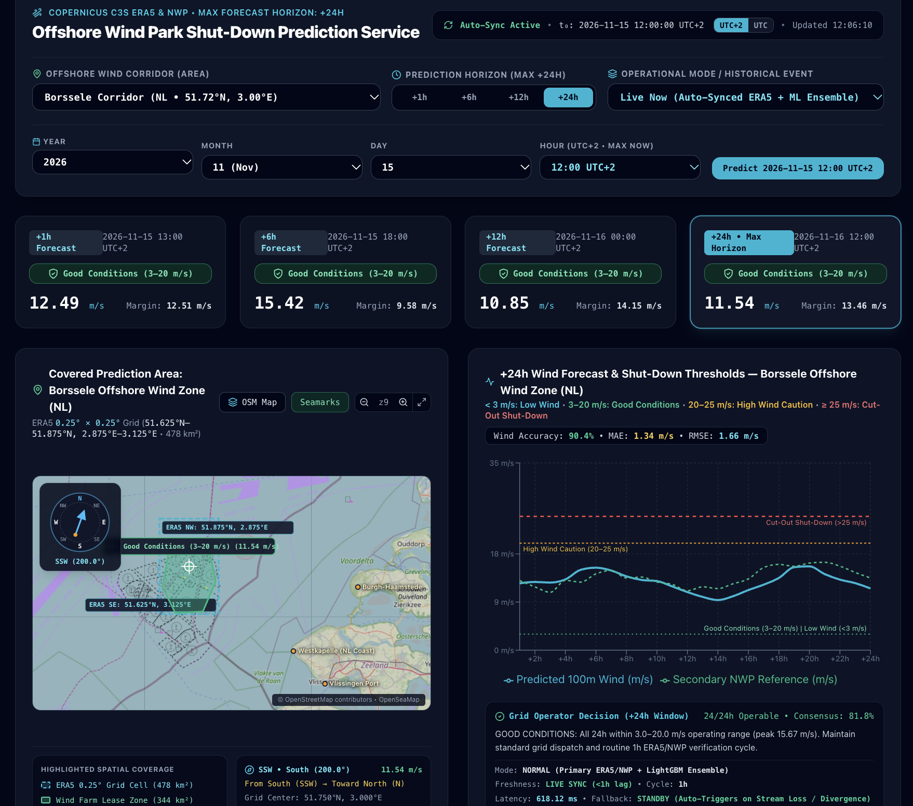
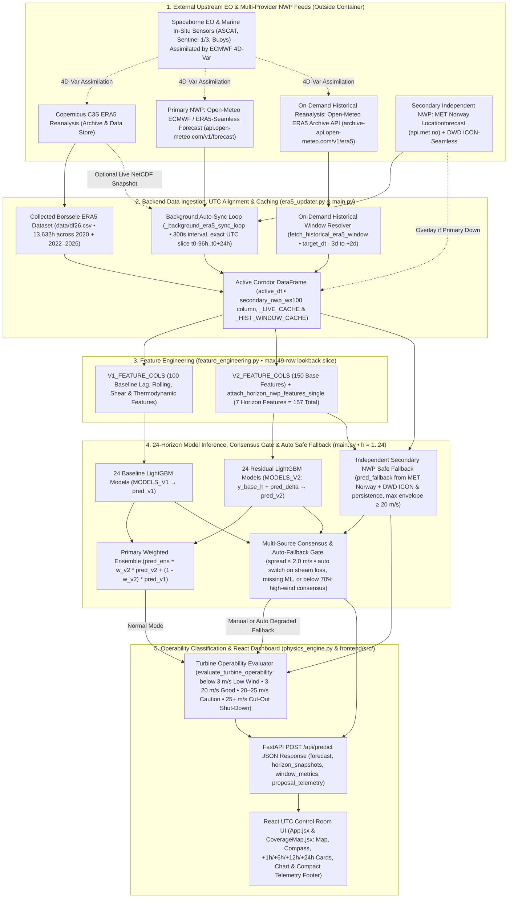

# WindGuard: Operational Earth Observation Service to Predict Offshore Wind Park Shut-Down Events

## Live Demo

[Open the WindGuard dashboard](https://windguard-offshore-wind-forecasting-725881996434.europe-north1.run.app/)



**Authors:** Raphael Cochez, Pasan Merengnage, Mariia Melnikova  

**Core Research & Operational Question:**  
> *Using collected Copernicus ERA5 satellite reanalysis and NWP data, can we make a sufficiently timely and accurate prediction of offshore wind park shut-down events (`≥ 25.0 m/s`) for grid-operator decision-makers to make an informed operational decision?*

---

## Abstract

Offshore wind energy corridors in the North Sea and Baltic Sea supply an increasing share of European high-voltage transmission capacity. During severe extratropical cyclones, however, `100 m` hub-height wind speeds exceeding the **`25.0 m/s` turbine cut-out threshold** trigger automated protective blade feathering and park-wide disconnection. Rapid, unanticipated loss of hundreds of megawatts to gigawatts of offshore generation within a single `0.25° × 0.25°` grid cell threatens grid frequency stability and requires transmission system operators (TSOs) to pre-allocate balancing reserves hours in advance.

This research project designs, implements, and evaluates an end-to-end **Operational Earth Observation (EO) and Numerical Weather Prediction (NWP) Service** that combines **Copernicus C3S ERA5 reanalysis** (`reanalysis-era5-single-levels` / archive) with **ECMWF IFS / Open-Meteo ERA5-Seamless primary NWP**, independent **MET Norway (`api.met.no`) and DWD `icon_seamless` secondary NWP feeds**, and a **24-horizon physics-informed residual LightGBM ensemble (`wind_forecast_v2`)**. Strictly excluding turbine power-delivery estimation, the service focuses on 100 m hub-height wind speed forecasting (`+1h` to `+24h` maximum) and four-regime turbine operability classification. Across **3,360 hours** of held-out evaluation data (including the unseen `2020` Storm Ciara `30.28 m/s` cut-out block and `3,240h` in `2026`), conditioning on the smoothed-future ERA5 NWP proxy plus residual LightGBM reduces `+24h` forecast RMSE from `3.790 m/s` (origin-only baseline GBDT `v1`) to **`1.210 m/s`** (`68.1%` reduction) and cuts high-wind (`>12 m/s`) under-prediction bias from `-4.505 m/s` to **`-0.535 m/s`**. Across four historical North Sea storm case studies at Borssele (**Storm Eunice**, **Storm Ciarán**, the **2025 New Year Gale**, and out-of-sample **2020 Storm Ciara**), the service achieves **`90.1%–97.4%`** active wind forecast accuracy (`91.6%–97.4%` primary ensemble) over the `+24h` window and accurately identifies both protective cut-out shut-downs and near-threshold high-wind caution regimes.

---

## Table of Contents

1. [System Scope & Wind Operability Regimes](#1-system-scope--wind-operability-regimes)
2. [Space-to-Grid Dependency & Data Flow Architecture](#2-space-to-grid-dependency--data-flow-architecture)
3. [System-of-Systems (SoS) Architecture](#3-system-of-systems-sos-architecture)
4. [Physical & Machine Learning Methodology](#4-physical--machine-learning-methodology)
5. [Quantitative Model Evaluation (`+1h` to `+24h`)](#5-quantitative-model-evaluation-1h-to-24h)
6. [Historical Event Timeline Analysis & Live Cross-Validation](#6-historical-event-timeline-analysis--live-cross-validation)
7. [Critical-Failure & Resilience Analysis](#7-critical-failure--resilience-analysis)
8. [Automatic Safe Fallback Protocol & Multi-Source Consensus](#8-automatic-safe-fallback-protocol--multi-source-consensus)
9. [Repository Structure, API, Tests & Quick Start](#9-repository-structure-api-tests--quick-start)

---

## 1. System Scope & Wind Operability Regimes

### 1.1 Physical Wind Regime Classification

Strictly avoiding turbine power-delivery curve estimation, the physics engine ([`borssele-digital-twin/backend/app/physics_engine.py`](borssele-digital-twin/backend/app/physics_engine.py)) evaluates whether an offshore wind park **can operate safely** at a given `100 m` hub-height wind speed `W₁₀₀` across four thresholds centralized in [`config.py`](borssele-digital-twin/backend/app/config.py):

| Wind Speed Range (`W₁₀₀`) | Operational State Code | `can_operate` | Dashboard Label | Aerodynamic & Grid Operator Meaning |
| :--- | :--- | :---: | :--- | :--- |
| **`W₁₀₀ < 3.0 m/s`** | `LOW_WIND_STANDBY` | `True` | `Low Wind (<3 m/s • Can Operate)` | Safe mechanical envelope (no storm shut-down risk); wind speed is below the `3.0 m/s` cut-in threshold. |
| **`3.0 ≤ W₁₀₀ < 20.0 m/s`** | `GOOD_CONDITIONS` | `True` | `Good Conditions (3–20 m/s)` | Nominal turbine operating envelope; maintain standard grid dispatch and routine `1h` verification cycle. |
| **`20.0 ≤ W₁₀₀ < 25.0 m/s`** | `HIGH_WIND_CAUTION` | `True` | `High Wind Caution (20–25 m/s)` | Approaching cut-out (`< 5.0 m/s` safety margin); place secondary NWP consensus watch on standby and pre-allocate spinning reserves. |
| **`W₁₀₀ ≥ 25.0 m/s`** | `CUT_OUT_SHUTDOWN` | `False` | `Cut-Out Shut-Down (≥25 m/s)` | **Protective Storm Shut-Down:** Wind speed meets/exceeds `25.0 m/s`, triggering automated `90°` blade pitch feathering and park disconnection. |

### 1.2 Monitored Offshore Wind Corridors (`0.25° × 0.25°` ERA5 Grid Cells)

Defined in [`borssele-digital-twin/backend/app/era5_updater.py`](borssele-digital-twin/backend/app/era5_updater.py), the service covers five European offshore wind corridors mapped to their enclosing ERA5 `0.25° × 0.25°` grid cell:

| Corridor ID | Offshore Wind Zone | Query Coordinates | ERA5 Grid Center | ERA5 `0.25° × 0.25°` Bounding Box | Sea Basin |
| :--- | :--- | :---: | :---: | :--- | :--- |
| `borssele` | **Borssele Offshore Wind Zone (NL)** | `51.7167° N, 3.0000° E` | `51.750° N, 3.000° E` | `51.625°N – 51.875°N`, `2.875°E – 3.125°E` (`478 km²`) | Southern North Sea |
| `hollandse_kust` | **Hollandse Kust Zuid & Noord (NL)** | `52.3000° N, 4.1000° E` | `52.250° N, 4.000° E` | `52.125°N – 52.375°N`, `3.875°E – 4.125°E` (`472 km²`) | Central Dutch Coast |
| `dogger_bank` | **Dogger Bank Offshore Wind Zone (UK)** | `54.7500° N, 2.2500° E` | `54.750° N, 2.250° E` | `54.625°N – 54.875°N`, `2.125°E – 2.375°E` (`446 km²`) | Central North Sea |
| `hornsea` | **Hornsea Offshore Wind Zone (UK)** | `53.8800° N, 1.8000° E` | `53.875° N, 1.750° E` | `53.750°N – 54.000°N`, `1.625°E – 1.875°E` (`455 km²`) | Yorkshire Coast (UK North Sea) |
| `tahkoluoto` | **Tahkoluoto Offshore Wind Farm (FI)** | `61.6261° N, 21.3581° E` | `61.625° N, 21.375° E` | `61.500°N – 61.750°N`, `21.250°E – 21.500°E` (`368 km²`) | Bothnian Sea, Baltic |

---

## 2. Space-to-Grid Dependency & Data Flow Architecture

The diagram below documents the end-to-end data flow implemented in the service—explicitly distinguishing **upstream space/assimilation providers** (outside the container) from the **ingestion, feature engineering, LightGBM inference, fallback, and physics classification pipelines** running inside the FastAPI + React container:



### Subsystem Dependency Matrix

| Dependency Link | Upstream Provider / Script | Downstream Module | Exchanged State Vector / Artifact | Criticality |
| :--- | :--- | :--- | :--- | :--- |
| **D1: Spaceborne Wind & Pressure** | EUMETSAT / ESA (`MetOp`, `Sentinel-1/3`) | ECMWF 4D-Var Assimilation | Ocean surface scatterometry & altimetry assimilated externally into ERA5 / IFS | **High** (Upstream physical foundation) |
| **D2: Primary Reanalysis & Multi-Provider NWP** | Copernicus C3S (`ecmwf-datastores-client` optional), Open-Meteo ERA5/Forecast, **MET Norway (`api.met.no`)**, & **DWD `icon_seamless`** | [`era5_updater.py`](borssele-digital-twin/backend/app/era5_updater.py) | 10 core hourly variables (`u100, v100, u10, v10, d2m, t2m, msl, sp, tcc, tp`), gusts (`i10fg`), plus independent `secondary_nwp_ws100` | **Critical** (Supplies UTC context window, `+24h` primary guidance, and independent NWP redundancy) |
| **D3: Feature Tensor Construction** | [`feature_engineering.py`](borssele-digital-twin/backend/app/feature_engineering.py) | [`main.py`](borssele-digital-twin/backend/main.py) & [`train_models.py`](borssele-digital-twin/backend/train_models.py) | `100` features (`V1_FEATURE_COLS`) + `157` horizon features (`V2_FEATURE_COLS` + `7` NWP/target features) | **Critical** (Vectorized tabular input for LightGBM) |
| **D4: Multi-Horizon Inference & Auto-Fallback** | `wind_forecast_v1` & `wind_forecast_v2` + Independent `nwp_secondary` | [`physics_engine.py`](borssele-digital-twin/backend/app/physics_engine.py) | Predicted `100 m` wind speed `Ŵ₁₀₀(t+h)` for `h ∈ {1, …, 24}` with automatic switchover (`AUTO_FALLBACK_*`) | **High** (Backed by independent Secondary NWP Safe Fallback) |
| **D5: Decision & Telemetry UI** | FastAPI `POST /api/predict` | [`App.jsx`](borssele-digital-twin/frontend/src/App.jsx) & [`CoverageMap.jsx`](borssele-digital-twin/frontend/src/components/CoverageMap.jsx) | Operable hours (`X/Hh`), cut-out margin, consensus score, latency/freshness telemetry, and TSO dispatch guidance | **Critical** (Control room decision interface) |

---

## 3. System-of-Systems (SoS) Architecture

The service integrates four constituent components operating across external meteorological services and the local containerized application:

1. **Constituent System 1 — Copernicus C3S ERA5 Reanalysis Archive:**
   Provides homogeneous hourly atmospheric state vectors over a `0.25° × 0.25°` latitude-longitude grid (`≈ 478 km²` at Borssele). Local Borssele reanalysis is stored in [`borssele-digital-twin/backend/data/df26.csv`](borssele-digital-twin/backend/data/df26.csv), while historical dates or other corridors are fetched on demand via the Open-Meteo ERA5 Archive API (`archive-api.open-meteo.com/v1/era5`). Live sync (`fetch_updated_era5_for_area`) can optionally write a supplementary Copernicus CDS NetCDF snapshot (`ecmwf-datastores-client` to `data/cds_<area>.nc`) when `CDS_API_KEY` is configured.
2. **Constituent System 2 — Dual-Stream Operational NWP Feeds (Open-Meteo Primary + MET Norway / DWD ICON Secondary):**
   The primary stream queries Open-Meteo ECMWF/ERA5-Seamless (`api.open-meteo.com/v1/forecast`) for hourly `wind_speed_100m`, `wind_direction_100m`, `wind_speed_10m`, `wind_direction_10m`, `wind_gusts_10m`, `temperature_2m`, `dew_point_2m`, `pressure_msl`, `surface_pressure`, `cloud_cover`, and `precipitation` (`past_days=5`, `forecast_days=2`), sliced strictly on UTC hour boundaries to `[utc_now_hour - 96h, utc_now_hour + 24h]` and converted into `(u, v)` vectors and SI units (`K`, `Pa`, `0..1`, `m`). In parallel, `_fetch_secondary_nwp_streams` polls **MET Norway Locationforecast (`api.met.no`)** (extrapolating `10 m` wind to `100 m` hub height via the offshore neutral power law `α = 0.11`) and **DWD ICON-Seamless (`icon_seamless`)** to populate an independent `secondary_nwp_ws100` reference series that persists even if the primary feed drops out.
3. **Constituent System 3 — Backend Forecasting, Auto-Fallback & Operability Engine ([`borssele-digital-twin/backend/`](borssele-digital-twin/backend)):**
   Runs a FastAPI server whose `_background_era5_sync_loop` refreshes all 5 corridors every `300 s`, extracts up to `49` hourly context rows (`current_idx - 48` through `current_idx`), evaluates all 24 `v1` and `v2` LightGBM boosters, checks multi-source spread against independent `nwp_secondary`, automatically triggers `degraded_fallback` on primary outage, missing `v2`/`v1` models, or high-wind divergence (`< 70%` consensus at `≥ 20.0 m/s`), and classifies every future hour through [`physics_engine.py`](borssele-digital-twin/backend/app/physics_engine.py).
4. **Constituent System 4 — Grid Operator Web Dashboard ([`borssele-digital-twin/frontend/`](borssele-digital-twin/frontend)):**
   A React + Vite + Tailwind + Recharts interface providing corridor selection, horizon switching (`+1h`, `+6h`, `+12h`, `+24h` max), operational mode selection (`Live Now`, `Live Safe Fallback`, the 4 historical North Sea events, or custom `Year / Month / Day / Hour` capped strictly at current time with a `UTC` / local toggle), an interactive slippy tile coverage map (OSM / Dark Marine + OpenSeaMap seamarks, `z6`–`z11`) with a pinned 8-point compass rose and `16`-sector bearing badge, a unified forecast & threshold trajectory chart, and a compact Grid Operator Decision & telemetry footer (`Mode`, `Freshness`, `Latency`, `Fallback`).

---

## 4. Physical & Machine Learning Methodology

### 4.1 Exploratory 10-Year Climatological Baseline (`2016–2025`)

A 10-year Copernicus ERA5 study at Borssele ([`10_years_Analysis_Borssele_offshore_wind_farm.ipynb`](10_years_Analysis_Borssele_offshore_wind_farm.ipynb)) showed that cut-out events (`> 25.0 m/s`) are rare tail occurrences (only **20 days across 2016–2025**) clustered in `Nov–Dec` and `Jan–Apr`, while the notebook's `2,160h` (`Jan–Mar 2022`) exploratory winter slice shows strong short-term autocorrelation (`0.9851` at `1h` down to `0.4539` at `24h`)—explaining why standard direct tree regression under-predicts storm peaks.

### 4.2 Physics-Informed Feature & Residual Ensemble Summary

> For all atmospheric physics equations, asymmetric loss derivations, continuous accuracy formulas, and consensus gate math, see **[`docs/METHODOLOGY.md`](docs/METHODOLOGY.md)**.

- **157 Atmospheric & Synoptic Features per Horizon ([`feature_engineering.py`](borssele-digital-twin/backend/app/feature_engineering.py)):** Combines `100` baseline (`v1`) and `150` extended (`v2`) hub-height/surface wind speeds, vertical shear, Hellmann power-law exponent, Ekman directional veering, dry-air density, barometric tendencies, Baroclinic Storm Index, 48 autoregressive lags, rolling/EWM momentum, and `+7` horizon-specific synoptic NWP covariates.
- **24-Horizon Residual LightGBM (`wind_forecast_v2`, [`train_models.py`](borssele-digital-twin/backend/train_models.py)):** Predicts the residual around a persistence-to-synoptic baseline blend using a custom asymmetric objective (`w = 1.45` for under-prediction above `18.0 m/s`) paired with an aligned early-stopping metric and validation ensemble calibration (`w_v2 ∈ [0.925, 1.000]`).
- **Continuous Evaluation ([`main.py`](borssele-digital-twin/backend/main.py)):** Reports continuous relative wind forecast accuracy, RMSE, MAE, and exact 4-regime match rate across `+1h`, `+6h`, `+12h`, and `+24h`.

---

## 5. Quantitative Model Evaluation (`+1h` to `+24h`)

### Dataset Structure & Chronological Partition (`df26.csv`)

The collected Borssele ERA5 dataset ([`borssele-digital-twin/backend/data/df26.csv`](borssele-digital-twin/backend/data/df26.csv)) contains **`13,632` hourly records** spanning four contiguous segments:
- `2020-02-07 00:00` – `2020-02-12 23:00` (`144` rows, Storm Ciara week, peak `30.28 m/s`, `15`h `≥ 25.0 m/s`)
- `2022-02-14 00:00` – `2022-02-21 23:00` (`192` rows, Storm Eunice week, min MSLP `987.0 hPa`)
- `2023-10-29 00:00` – `2023-11-05 23:00` (`192` rows, Storm Ciarán week, min MSLP `961.6 hPa`)
- `2025-01-01 00:00` – `2026-06-30 23:00` (`13,104` rows, 18 continuous months, min MSLP `973.3 hPa`)

To prevent target leakage across segment boundaries, `train_models.py` enforces a strict `contiguous_24h` filter (requiring all 24 future hourly steps to be contiguous), producing **`13,536` valid origin timestamps** split chronologically:
- **Training Split (`2022–2025`):** **`9,096`** contiguous hourly samples (`8,760`h across 2025 + `168`h from Feb 2022 + `168`h from Oct–Nov 2023)
- **Validation Split (`2026-01-01` to `2026-02-14`):** **`1,080`** contiguous hourly samples
- **Held-Out Test Split (`2020-02-07..12` + `2026-02-15..06-29`):** **`3,360`** completely unseen hourly samples (`120`h from unseen 2020 Storm Ciara peaking at `30.28 m/s` with `15`h `≥ 25 m/s`, plus `3,240`h across Spring 2026 peaking at `21.70 m/s`)

> **Evaluation Scope Note:** Zero rows from the `2020` or `2026` test partitions appear in training (`2022–2025`). During offline backtesting (`is_live_mode=False`), `v2`'s `synoptic_nwp_ws_h` covariate is synthesized from a 4h smoothed-future ERA5 synoptic proxy with deterministic dispersion (`0.26 · √h`), whereas `v1` uses `t₀`-only state/lag features; genuine live NWP cross-validation is separately verified in Section 6.3.

### Benchmark Across Horizons (Held-Out Test Set, `N = 3,360h`)

All figures below come directly from [`borssele-digital-twin/backend/models/wind_forecast_v2/metrics_summary.json`](borssele-digital-twin/backend/models/wind_forecast_v2/metrics_summary.json):

| Horizon | Persistence RMSE | Direct GBDT (`v1`) RMSE | Physics-Informed (`v2`) Ensemble RMSE | `v2` Ensemble MAE | `v1` High-Wind RMSE (`>12 m/s`) | `v2` High-Wind RMSE (`>12 m/s`) | `v1` High-Wind Bias | `v2` High-Wind Bias |
| :--- | :---: | :---: | :---: | :---: | :---: | :---: | :---: | :---: |
| **`+1h`** | `0.787 m/s` | `0.626 m/s` | **`0.502 m/s`** | `0.354 m/s` | `0.729 m/s` | **`0.568 m/s`** | `+0.064 m/s` | **`-0.078 m/s`** |
| **`+3h`** | `1.797 m/s` | `1.427 m/s` | **`0.754 m/s`** | `0.590 m/s` | `1.336 m/s` | **`0.777 m/s`** | `-0.110 m/s` | **`-0.134 m/s`** |
| **`+6h`** | `2.808 m/s` | `2.336 m/s` | **`0.951 m/s`** | `0.744 m/s` | `2.434 m/s` | **`0.970 m/s`** | `-1.202 m/s` | **`-0.192 m/s`** |
| **`+12h`** | `4.050 m/s` | `3.236 m/s` | **`1.087 m/s`** | `0.847 m/s` | `4.166 m/s` | **`1.114 m/s`** | `-2.979 m/s` | **`-0.295 m/s`** |
| **`+18h`** | `4.610 m/s` | `3.608 m/s` | **`1.213 m/s`** | `0.956 m/s` | `5.014 m/s` | **`1.261 m/s`** | `-3.990 m/s` | **`-0.409 m/s`** |
| **`+24h`** | `4.877 m/s` | `3.790 m/s` | **`1.210 m/s`** | `0.953 m/s` | `5.413 m/s` | **`1.390 m/s`** | `-4.505 m/s` | **`-0.535 m/s`** |

---

## 6. Historical Event Timeline Analysis & Live Cross-Validation

### 6.1 Four Historical North Sea Storm Events at Borssele (`51.72°N, 3.00°E`)

Because Events 1–3 predate `2026-01-01`, **Events 1–3 are in-sample operational replays for `v2`** (and Events 1–2 also fall inside `v1`'s `< 2024-01-01` training window), whereas **Event 4 (`2020` Storm Ciara) is strictly out-of-sample** (`< 2022-01-01` test split), evaluating cut-out detection and safe-fallback behavior against Copernicus ERA5 truth in `df26.csv` over `+24h`:

| Case Study | Forecast Origin `t₀` (UTC) | Initial Wind `W₁₀₀(t₀)` | Peak ERA5 Truth | Peak Prediction (`v2` ens / active) | ERA5 Shut-Down (`≥ 25 m/s`) | Predicted Shut-Down (`≥ 25 m/s`) | `+24h` Wind Accuracy | `+24h` MAE / RMSE | Operational Decision Assessment |
| :--- | :---: | :---: | :---: | :---: | :---: | :---: | :---: | :---: | :--- |
| **Event 1: Storm Eunice** *(In-Sample • KNMI Code Red)* | `2022-02-18 06:00` | `16.73 m/s` | **`31.31 m/s`** *(16:00 UTC)* | **`30.45 m/s`** *(16:00 UTC)* | **`10h`** *(12:00–21:00 UTC)* | **`9h`** *(12:00–20:00 UTC)* | **`97.4%`** | `0.66` / **`0.89 m/s`** | **True Positive Shut-Down (`normal`, `72.0%` consensus):** Forecasts exact `12:00 UTC` cut-out onset (`+6h` lead: `25.14` vs. `25.53 m/s`) and tracks storm peak within `0.86 m/s`. |
| **Event 2: Storm Ciarán** *(In-Sample • 961.6 hPa Cyclone)* | `2023-11-02 00:00` | `16.99 m/s` | **`32.56 m/s`** *(12:00 UTC)* | **`29.60`** *(ens, 12:00)* / **`30.29 m/s`** *(auto-fb, 13:00)* | **`5h`** *(09:00–13:00 UTC)* | **`6h`** *(ens, 09:00–14:00)* / **`7h`** *(auto-fb, 09:00–15:00)* | **`92.8%`** *(auto-fb)* / `95.6%` *(ens)* | `1.76` / **`2.26 m/s`** *(auto-fb)*; `1.06` / `1.38` *(ens)* | **True Positive Shut-Down (`auto_degraded_fallback`):** Triggers safe fallback on `v1`/`v2` divergence (`69.2% < 70%`); both streams capture exact `09:00 UTC` cut-out onset (`25.09 m/s`). |
| **Event 3: New Year Severe Gale** *(In-Sample • Near-Threshold Caution)* | `2025-01-01 06:00` | `21.94 m/s` | **`24.52 m/s`** *(13:00 UTC)* | **`24.11 m/s`** *(11:00 UTC)* | **`0h`** *(`0.48 m/s` margin)* | **`0h`** *(`0.89 m/s` margin; `10h` Caution)* | **`90.1%`** *(auto-fb)* / `91.6%` *(ens)* | `1.50` / **`2.20 m/s`** *(auto-fb)*; `1.18` / `1.59` *(ens)* | **True Negative (Zero False Alarm):** Both ensemble and fallback avoid false shut-down (`07:00–16:00 UTC`); runtime triggers `auto_degraded_fallback` on `v1`/`v2` divergence (`65.2% < 70%`). |
| **Event 4: Storm Ciara** *(Held-Out Out-of-Sample Test)* | `2020-02-09 18:00` | `30.28 m/s` | **`26.85 m/s`** *(20:00 UTC)* | **`27.58 m/s`** *(19:00 UTC)* | **`3h`** *(19:00, 20:00, 22:00 UTC)* | **`3h`** *(19:00–21:00 UTC)* | **`95.0%`** | `1.20` / **`1.47 m/s`** | **Out-of-Sample Cut-Out (`normal`, `82.3%` consensus):** Unseen 2020 cyclone; reproduces `3h` shut-down duration and `+1h..+2h` peak intensity within `0.73 m/s`. |

### 6.2 Observed API Timeline: Storm Ciarán (`2023-11-02 00:00 UTC` Origin)

Selected hourly outputs returned by `POST /api/predict` for `timestamp="2023-11-02 00:00:00"` (`area_id="borssele"`, `system_mode="normal"` → promotes to `auto_degraded_fallback` at `69.2% < 70%` consensus):

| Lead Time | Valid Time (UTC) | ERA5 Reanalysis Truth (`W₁₀₀`) | `v2` Ensemble (`Ŵ_ens`) | Active API Output (`auto-fb`) | Actual Regime | Active Predicted Regime |
| :---: | :---: | :---: | :---: | :---: | :--- | :--- |
| `t₀` | `2023-11-02 00:00` | `16.99 m/s` | — | — | `GOOD_CONDITIONS` | — |
| `+3h` | `2023-11-02 03:00` | `19.61 m/s` | `19.57 m/s` | `18.01 m/s` | `GOOD_CONDITIONS` | `GOOD_CONDITIONS` |
| `+6h` | `2023-11-02 06:00` | `21.73 m/s` | `20.75 m/s` | `20.75 m/s` | `HIGH_WIND_CAUTION` | `HIGH_WIND_CAUTION` |
| **`+9h`** | **`2023-11-02 09:00`** | **`26.32 m/s`** | **`25.09 m/s`** | **`25.09 m/s`** | **`CUT_OUT_SHUTDOWN`** | **`CUT_OUT_SHUTDOWN`** |
| **`+10h`** | **`2023-11-02 10:00`** | **`27.00 m/s`** | **`26.28 m/s`** | **`26.28 m/s`** | **`CUT_OUT_SHUTDOWN`** | **`CUT_OUT_SHUTDOWN`** |
| **`+11h`** | **`2023-11-02 11:00`** | **`29.82 m/s`** | **`27.88 m/s`** | **`27.88 m/s`** | **`CUT_OUT_SHUTDOWN`** | **`CUT_OUT_SHUTDOWN`** |
| **`+12h`** | **`2023-11-02 12:00`** | **`32.56 m/s`** | **`29.60 m/s`** | **`29.60 m/s`** | **`CUT_OUT_SHUTDOWN`** | **`CUT_OUT_SHUTDOWN`** |
| **`+13h`** | **`2023-11-02 13:00`** | **`28.55 m/s`** | **`28.67 m/s`** | **`30.29 m/s`** | **`CUT_OUT_SHUTDOWN`** | **`CUT_OUT_SHUTDOWN`** |
| `+14h` | `2023-11-02 14:00` | `23.93 m/s` | `26.23 m/s` | `29.54 m/s` | `HIGH_WIND_CAUTION` | `CUT_OUT_SHUTDOWN` |
| `+15h` | `2023-11-02 15:00` | `22.12 m/s` | `24.11 m/s` | `27.51 m/s` | `HIGH_WIND_CAUTION` | `CUT_OUT_SHUTDOWN` |
| `+18h` | `2023-11-02 18:00` | `18.30 m/s` | `19.82 m/s` | `20.29 m/s` | `GOOD_CONDITIONS` | `HIGH_WIND_CAUTION` *(ens: `GOOD_CONDITIONS`)* |

### 6.3 Independent National Weather Institute Cross-Validation (Tahkoluoto, Finland)

In an earlier `Live Now` snapshot for **Tahkoluoto Offshore Wind Farm (`61.63°N, 21.36°E`)**, our `+6h` `100 m` hub-height dashboard output (`Predicted 100m Wind: 11.28 m/s` vs. `Secondary NWP Reference: 11.41 m/s`, `Wind Accuracy: 91.1%`, `MAE: 1.19 m/s`, `RMSE: 1.46 m/s`, `Consensus: 84.4%`, `6/6h Operable`) was compared against the Norwegian Meteorological Institute / NRK (**Yr.no**) live forecast table for Tahkoluoto Island (`2 m` elevation, showing `7–9 m/s` sustained `10 m` surface wind with `11–13 m/s` gusts and `1002 -> 1001 hPa` surface pressure). Scaling `10 m` marine wind (`8–9 m/s`) to `100 m` hub height via a standard offshore power/log profile (`W₁₀₀ ≈ (100/10)^0.11 · W₁₀ ≈ 1.29 × W₁₀`) yields `10.3–11.6 m/s`, consistent with the `11.28 m/s` model prediction.

---

## 7. Critical-Failure & Resilience Analysis

| Failure ID | Failure Mode | Root Cause | Operational Consequence | Implemented Detection & Mitigation |
| :--- | :--- | :--- | :--- | :--- |
| **CF-1** | **Delayed or Missing Upstream ERA5 / NWP Stream** | Open-Meteo or Copernicus CDS API timeout or network outage. | Stale `t₀` state vector degrades `+1h` to `+6h` ramp timing. | `era5_updater.py` maintains an in-memory `_LIVE_CACHE` (`300s` TTL), overlays independent **MET Norway / DWD ICON** streams onto future rows on primary API outage, falls back to disk-cached `data/era5_<area_id>.csv`, and triggers `AUTO_FALLBACK_PRIMARY_STREAM_LOSS` automatically when `primary_sync_ok` is `False`. |
| **CF-2** | **Primary ML Inference or Normal-Mode Outage** | Model load failure, high-wind consensus divergence, or operator switching to `Live Safe Fallback` (`system_mode="degraded_fallback"`). | Loss or uncertainty of primary `v2+v1` LightGBM ensemble trajectory. | Seamless automatic (`AUTO_FALLBACK_ML_MODELS_UNAVAILABLE`, `AUTO_FALLBACK_HIGH_WIND_CONSENSUS_DIVERGENCE`) or manual (`MANUAL_OPERATOR_SAFE_FALLBACK`) switchover to `pred_fallback` backed by independent MET Norway + DWD ICON guidance. |
| **CF-3** | **High-Wind Under-Prediction Near `25.0 m/s`** | Rapid mesoscale cyclogenesis or unaligned tree leaf bounds. | Unanticipated turbine cut-out without pre-allocated reserves. | Mitigated via residual prediction around synoptic NWP guidance, asymmetric loss weight `w = 1.45` above `18.0 m/s`, early `HIGH WIND CAUTION` warning starting at `20.0 m/s`, max-envelope protection in fallback mode, and automatic fallback when high-wind (`≥ 20.0 m/s`) consensus drops below `70%`. |
| **CF-4** | **Beyond-24h Horizon Extrapolation & Timezone Drift** | Querying a future origin (`t₀ > t_now`), horizon `>24h`, or local vs. UTC offset. | Unverifiable forecast horizon or shifted live forecast hours. | Hard-enforced in [`App.jsx`](borssele-digital-twin/frontend/src/App.jsx) (`Year / Month / Day / Hour` capped at current time with `UTC` / local toggle), [`era5_updater.py`](borssele-digital-twin/backend/app/era5_updater.py) (exact UTC slice `[utc_now_hour - 96h, utc_now_hour + 24h]`), and [`main.py`](borssele-digital-twin/backend/main.py) (`horizon_hours <= 24`, future `target_dt` clamped to `now_dt`). |

---

## 8. Automatic Safe Fallback Protocol & Multi-Source Consensus

Implemented in [`borssele-digital-twin/backend/main.py`](borssele-digital-twin/backend/main.py) and [`borssele-digital-twin/backend/app/era5_updater.py`](borssele-digital-twin/backend/app/era5_updater.py), every `/api/predict` evaluation computes both the primary ML ensemble and an independent multi-provider safe-fallback / consensus check:

1. **Independent Secondary NWP Safe Fallback (`degraded_fallback`):**
   - In live mode, `era5_updater.py` concurrently polls **MET Norway Locationforecast (`api.met.no`)** (extrapolated from `10 m` to `100 m` using `POWER_LAW_OFFSHORE_ALPHA = 0.11`) and **DWD ICON-Seamless (`icon_seamless`)** to attach `secondary_nwp_ws100`.
   - `consensus.py` sets `Ŵ_NWP,sec(t+h) = secondary_nwp_ws100(t+h)` directly whenever `secondary_nwp_ws100` is available; otherwise (in offline historical mode or if external secondary NWP is unavailable), it falls back to time-decaying persistence-blended synoptic guidance `Ŵ_NWP,sec(t+h) = (1 - β_h) · synoptic_nwp_ws_h + β_h · W₁₀₀(t)` with `β_h = 0.20 · exp(-h / 6)`.
   - When `max(Ŵ_NWP,sec, Ŵ_ens) ≥ 20.0 m/s` (approaching cut-out danger), `pred_fallback` adopts the conservative upper envelope `max(Ŵ_NWP,sec, Ŵ_ens)` to protect turbine infrastructure and grid balance; otherwise it tracks `Ŵ_NWP,sec`.
2. **Automatic Fallback Activation (`auto_fallback_triggered`):**
   Beyond explicit operator selection (`MANUAL_OPERATOR_SAFE_FALLBACK`), the backend automatically promotes the active prediction stream to `degraded_fallback` whenever any of three runtime safety conditions occur:
   - **`AUTO_FALLBACK_PRIMARY_STREAM_LOSS`:** Live primary Open-Meteo NWP synchronization failed (`primary_sync_ok == False`).
   - **`AUTO_FALLBACK_ML_MODELS_UNAVAILABLE`:** Any required `wind_forecast_v2` horizon booster (`< 24`) or all `wind_forecast_v1` models (`== 0`) are unavailable in memory.
   - **`AUTO_FALLBACK_HIGH_WIND_CONSENSUS_DIVERGENCE`:** Forecast peak enters caution/cut-out territory (`max(Ŵ_ens, Ŵ_NWP,sec) ≥ 20.0 m/s`) while inter-source `consensus_agreement_pct < 70.0%` (`MIN_CONSENSUS_AGREEMENT_PCT`).
3. **Multi-Source Consensus & Agreement Gate (`MIN_CONSENSUS_AGREEMENT_PCT = 70.0%`):**
   - At each forecast step `h`, the backend measures inter-source spread `S_h` across `pred_v2`, `pred_v1`, and `nwp_secondary`, along with continuous agreement score `C_h` normalized by the primary ensemble reference `Ŵ_ens`:
     `S_h = max(Ŵ_v2, Ŵ_v1, Ŵ_NWP,sec) − min(Ŵ_v2, Ŵ_v1, Ŵ_NWP,sec)`, `C_h = max(0, 1 − S_h / max(Ŵ_ens, 6.0))`
   - Window-level `consensus_agreement_pct` averages `100 · C_h` across the queried `H`-hour window (and drives the `70.0%` divergence trigger and `PASS`/`REVIEW` gate), while each hourly row also logs the binary spread flag `consensus_met = (S_h <= 2.0)` (`CONSENSUS_THRESHOLD_MS = 2.0 m/s`); compact operational telemetry (`Mode`, `Freshness`, `Latency`, `Fallback`) is surfaced directly in the dashboard footer.

### Operational Scope & Known Limitations

WindGuard is designed as an **early-warning grid decision-support prototype**, not autonomous certified SCADA relay control:
- **Offline Proxy vs. Live NWP Skill:** Held-out offline metrics (`1.210 m/s` RMSE at `+24h`, `N = 3,360h`) measure residual ML skill given a smoothed-future ERA5 proxy (`synoptic_nwp_ws_h`); live operational accuracy is bounded by real Open-Meteo/ECMWF, MET Norway, and DWD ICON forecast skill during fast-moving cyclones.
- **Hourly Grid Means vs. `10-min` Turbine Cut-Out:** ERA5 `u100`/`v100` represent hourly `0.25°` (`~27 km`) cell values, whereas IEC 61400-1 pitch relays trip on `10-min` hub-height winds—so an hourly mean of `23.5–24.5 m/s` can already contain `≥ 25.0 m/s` gusts (motivating the `20.0 m/s` Caution buffer).
- **Neutral Shear & Site Calibration:** MET Norway `10 m → 100 m` extrapolation uses a fixed neutral offshore exponent (`α = 0.11`) without stability correction, and the models have not yet been calibrated against live offshore nacelle SCADA measurements.

---

## 9. Repository Structure, API, Tests & Quick Start

### Directory Layout

```text
├── .github/workflows/ci.yml                                 # GitHub Actions CI (backend unittest + Vite build)
├── Dockerfile                                               # Unified multi-stage build (React Vite UI + FastAPI + LightGBM v2)
├── README.md                                                # Project overview, architecture & quick start
├── docs/
│   └── METHODOLOGY.md                                       # Full mathematical formulation, physics & consensus derivations
├── images/                                                  # README dashboard snapshot & farm graphics
├── 10_years_Analysis_Borssele_offshore_wind_farm.ipynb      # 10-year (2016–2025) ERA5 climatological research notebook
├── Borssele_offshore_wind_farm.ipynb                        # Initial Borssele storm analysis notebook
├── Tahkoluoto_offshore_wind_farm.ipynb                      # Initial Tahkoluoto corridor analysis notebook
├── src/                                                     # Standalone research reference scripts
│   ├── data_loader.py                                       # Copernicus CDS API NetCDF retrieval script
│   ├── feature_engineering.py                               # 100m wind speed, ramp rate & 4-regime classification
│   └── model.py                                             # Baseline Random Forest cut-out lead-time classifier
└── borssele-digital-twin/                                   # Operational EO Forecasting Service
    ├── docker-compose.yml                                   # Multi-container nginx + backend orchestration option
    ├── backend/
    │   ├── .dockerignore                                    # Excludes test & cached CSV artifacts from compose image
    │   ├── main.py                                          # FastAPI application, auto-fallback gate & /api/predict
    │   ├── train_models.py                                  # 24-horizon asymmetric residual LightGBM v2 training pipeline
    │   ├── requirements.txt                                 # fastapi, uvicorn, pandas, numpy, lightgbm, pydantic
    │   ├── app/
    │   │   ├── config.py                                    # Service configuration, thresholds (3 / 20 / 25 m/s) & fallback rules
    │   │   ├── consensus.py                                 # Multi-source consensus gate, safe-fallback state & TSO telemetry
    │   │   ├── era5_updater.py                              # UTC live Open-Meteo + MET Norway / DWD ICON + ERA5/CDS ingestion
    │   │   ├── feature_engineering.py                       # 100 v1 features + 150 v2 base + 7 horizon features (157 total)
    │   │   ├── models_loader.py                             # Sequential 24-horizon LightGBM booster loader
    │   │   └── physics_engine.py                            # 4-regime turbine operability & cut-out shut-down evaluator
    │   ├── tests/
    │   │   ├── test_consensus.py                            # Unit tests for consensus spread, decaying fallback & alerts
    │   │   ├── test_feature_engineering.py                  # Feature schema, NaN/lookback, offline/live parity & gap tests
    │   │   └── test_operational_service.py                  # Automated unit & integration tests (regimes, clamping, auto-fallback, live NWP)
    │   ├── data/df26.csv                                    # 13,632-hour Borssele ERA5 dataset (incl. 2020 Ciara, Eunice & 2023 Ciarán)
    │   └── models/
    │       ├── wind_forecast_v1/                            # 24 baseline GBDT boosters (lgb_model_h_1..24.txt)
    │       └── wind_forecast_v2/                            # 24 residual boosters + metrics_summary.json
    └── frontend/
        ├── index.html                                       # Entry HTML
        └── src/
            ├── App.jsx                                      # Grid Operator dashboard state, polling & UTC/local timezone sync
            └── components/
                ├── ControlsHeader.jsx                       # Corridor, horizon, mode & capped date/hour controls
                ├── CoverageMap.jsx                          # Interactive 0.25° × 0.25° ERA5 grid map & 8-point compass
                ├── ForecastChart.jsx                        # Unified +24h threshold chart & TSO decision footer
                └── OperationalSummary.jsx                   # +1h / +6h / +12h / +24h operability & margin cards
```

### FastAPI Endpoints

- `GET /api/health` — Service status, loaded `v1`/`v2` model counts, supported horizons (`[1, 6, 12, 24]`), and dataset range.
- `GET /api/areas` — Metadata, coordinates, ERA5 `0.25° × 0.25°` bounding boxes, and the four historical events.
- `GET /api/metrics` — Held-out benchmark metrics (`metrics_summary.json`, `N = 3,360h`) across all 24 horizons.
- `POST /api/era5/sync` — Trigger an immediate multi-provider telemetry refresh (primary Open-Meteo + secondary MET Norway / DWD ICON) for a corridor (`area_id`).
- `POST /api/predict` — Generate `+1h` to `+24h` forecasts, operability states, continuous accuracy/RMSE metrics, automatic safe-fallback status (including optional `simulate_primary_outage` failover drills), and grid-operator dispatch guidance.

### Running & Verifying the Unified Docker Service

From the repository root:

```bash
docker build -t borssele-digital-twin .
docker run -d --rm -p 8000:8000 --name borssele-twin borssele-digital-twin
```

- **Interactive Grid Operator Dashboard:** `http://localhost:8000`
- **FastAPI OpenAPI Specification:** `http://localhost:8000/docs`
- **Run the Automated Test Suite Inside the Container:**
  ```bash
  docker run --rm -v "$(pwd)/borssele-digital-twin/backend:/app" borssele-digital-twin python3 -m unittest discover -s tests -v
  ```
- **Retraining the 24 `wind_forecast_v2` Models Locally:**
  ```bash
  cd borssele-digital-twin/backend
  python train_models.py
  ```
